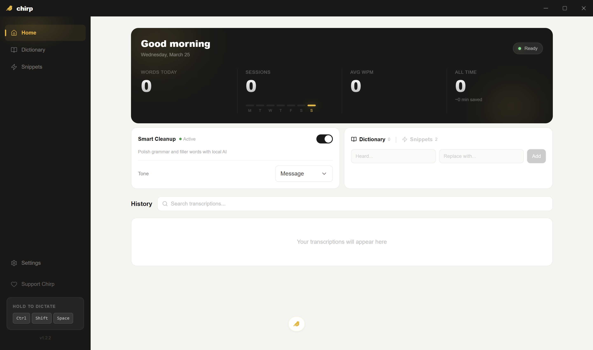

<p align="center">
  
</p>

# Chirp

**Press a key, talk, and polished text appears at your cursor.**

<p align="center">
  
</p>


> **Chirp v2 is in progress on this branch.** It's being rebuilt as a Windows-only app focused on two things: text appearing the moment you stop talking, and the best possible cleanup of what you said. See [docs/v2/DIRECTION.md](docs/v2/DIRECTION.md). The latest stable release (v1.3.4) is on the [Releases](https://github.com/sitelift/Chirp/releases/latest) page.

---

## What is Chirp?

Press a hotkey, talk, release. What you meant appears at your cursor as well-written text, in any app.

- **Speech recognition runs locally** on your GPU: NVIDIA's [Parakeet](https://huggingface.co/nvidia/parakeet-tdt-0.6b-v2) through [sherpa-onnx](https://github.com/k2-fsa/sherpa-onnx).
- **Cleanup uses Claude** (Anthropic API, bring your own key) to turn speech into proper writing: punctuation, lists, paragraphs, self-corrections. It reads the active app's name and window title so an email comes out as an email and a Slack reply as a Slack reply. *(In progress.)*
- **Windows only.** Built and tuned on Windows 11 with an NVIDIA GPU.

## Building from Source

### Prerequisites

- [Node.js](https://nodejs.org/) 18+
- [Rust](https://rustup.rs/) (stable)
- [CMake](https://cmake.org/)
- [LLVM/Clang](https://releases.llvm.org/)
- sherpa-onnx shared libraries (see below)

### sherpa-onnx Setup

Download the Windows x64 shared-library archive matching the `sherpa-onnx` crate version in `src-tauri/Cargo.toml` from [sherpa-onnx releases](https://github.com/k2-fsa/sherpa-onnx/releases) (the release workflow in `.github/workflows/release.yml` shows the exact archive). Copy the `.dll` and `.lib` files into `src-tauri/sherpa-onnx-lib/`, and the DLLs into `src-tauri/` as well for release bundling.

### Environment variables (bash)

```bash
export PATH="/c/Program Files/CMake/bin:/c/Program Files/LLVM/bin:$PATH"
export CARGO_TARGET_DIR="C:/tmp/chirp-target"   # Short path avoids MAX_PATH issues
export LIBCLANG_PATH="C:/Program Files/LLVM/bin"
```

### Dev & Build

```bash
npm install
npx tauri dev          # Dev server + Rust backend
npx tauri build        # Release build (creates installer)
```

## Tech Stack


| Layer              | Technology                               |
| ------------------ | ---------------------------------------- |
| App framework      | Tauri 2 (Rust)                           |
| Frontend           | React 19 + TypeScript + Vite             |
| Styling            | Tailwind CSS                             |
| Speech recognition | sherpa-onnx + NVIDIA Parakeet TDT        |
| Cleanup            | Regex pass + Claude Haiku (in progress)  |
| Audio capture      | cpal                                     |
| Text injection     | Win32 clipboard + SendInput              |


## License

The code is [MIT](LICENSE). The Chirp name, logo and icons are not; see [BRAND.md](BRAND.md).
